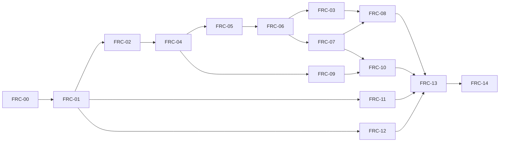

# Autonomous release-hardening run — 2026-09-20

- startedAt: 2026-09-20T14:12:33.402565+00:00
- Current task: ACTIVE under the 2026-09-21 continuation. FRC06 accepted locally; FRC03 and separate real vertical gate accepted locally; child commits recorded; FRC07 next. Continue through FRC07 → FRC08 → FRC10 → FRC13 → FRC14; no push or deployment.
- Execution: current checkout; no reset/rebase/push/deployment/production migration. Local commits only after accepted, separable changes.
- Authority: current user request, accepted ADR-0016/0017, then release package. Preserve historical evidence as history.

## Starting checkout

| Repository | Branch | HEAD | Origin relation | Starting worktree |
| --- | --- | --- | --- | --- |
| parent | develop | `b173183d85a02140b74189b4fde8875c46de4885` | fetched; 0 ahead / 0 behind | clean |
| frontend | develop | `8a5480fcc803da818cf0feeb135884f5bdcc1e68` | fetched; 0 ahead / 0 behind | clean |
| backend | develop | `b04696d87b5a5a085c9c5cc4eda1e7dacff8af12` | fetched; 0 ahead / 0 behind | clean |
| knowledge-base | develop | `80c12da92bfd253e367bc09963fba9dea66857d1` | fetched; 0 ahead / 0 behind | clean |

Parent gitlinks equal the child HEADs above. All four fetches completed; initial sandbox failures were retried with approved network/Git access. No checkout updates were necessary.

## Progress ledger

| FRC | Status | Tests | Runtime blockers | Commit | Next |
| --- | --- | --- | --- | --- | --- |
| FRC-00 | Implemented / Acceptance blocked by runtime evidence | Fresh baseline unittest: 10 PASS | Deployed identity/digests/migrations absent | Existing baseline | Preserve |
| FRC-01 | Implemented / code-level acceptance passed / runtime acceptance blocked | Fresh focused frontend + readiness verification | Deployment/TLS/production evidence | Existing baseline | Preserve |
| FRC-02 | CODE PASS / RUNTIME BLOCKED — entry gate passed in ADR-0017 scope | Fresh FE focused 31/31 + 5/5; BE isolation 7 top-level + 12 nested; readiness 1; save/version 11. Source audit found no tenant blocker | Production orphan inventory/storage/TLS remain; local PG/browser not yet rerun | Existing baseline | Preserve invariants |
| FRC-03 | PASS local staged + vertical gate | Browser29, focused9, full212PASS/6historicalFAIL/59SKIP; realCLI/PG/Next→Go→PG | No local blocker; production remains14 | frontend e49253b; backend5a4a6d5 | FRC07 GO |
| FRC-04 | CODE PASS / RUNTIME BLOCKED | REV01–10 PG+audit; BE full/unit/build/vet; FE roundtrip3/3+types/lint/build; independent review PASS; scoped OpenAPI valid | Production migration/deployed retention/runtime | Deferred shared hunks | FRC05+09 dependency satisfied |
| FRC-05 | CODE PASS / RUNTIME BLOCKED | COST01–11; FE27+browser9; liveGo/PG475000RUB; PG21+11; types/lint/build/SwaggerPASS | Deployed identity/migration/toolchain/TLS | Deferred shared hunks | FRC06 GO |
| FRC-06 | PASS (local staged scope) | 30 criteria; focused48, browser13, real Next→Go→PG; full201 PASS/6 historical FAIL/43 SKIP; types/lint/build | SAVE09 gated N/A until mandatory FRC10 | frontend a56d128; parent0560b79 | Preserve and regress |
| FRC-07 | RESEARCH READY | Approved budget semantics recorded in current user instruction and durable context | Wait FRC03 real vertical gate | — | Update historical plan against approved contract, then implement |
| FRC-08 | NOT STARTED | Not executed | Not assessed | — | Honor dependency graph below |
| FRC-09 | CODE PASS / RUNTIME BLOCKED | DATA01–10; Node23; Chromium23combined; actualbrowser/PG; race/build/lint/SwaggerPASS | Real scanner/privatevolume/retention/TLS | Deferred shared06hunks | Userrequestedstop |
| FRC-10 | NOT STARTED | Not executed | Not assessed | — | Honor dependency graph below |
| FRC-11 | CODE PASS / RUNTIME BLOCKED | Focused20/20+latest4/4, lint/types/build PASS; browser6 widths,11 direct routes, real login and demo marker PASS | Deployed origin/cookie/storage separation | Deferred: overlap with FRC12 landing | Preserve capabilities; final integrated suite |
| FRC-12 | CODE PASS / RUNTIME BLOCKED | Real PG+browser lost response/one row; form6/6, BFF7/7, identity15/15, full BE/build/types, independent review and scoped API PASS | Owner consent/retention/recipient, actual SMTP delivery/alert, ingress trust | Deferred shared hunks | Preserve; final integrated release gate |
| FRC-13 | NOT STARTED | Not executed | Not assessed | — | Honor dependency graph below |
| FRC-14 | NOT STARTED | Not executed | Not assessed | — | Honor dependency graph below |

## Execution graph

Dependencies listed by the package are acceptance prerequisites. This run additionally waits for required implementation before dependent implementation; no interpretation turns future FRC-07 budget enforcement into a cycle blocking FRC-04. FRC-13/14 preparation can run early; integrated acceptance runs last.

Exact prerequisites (including transitive edges) and acceptance scenarios follow. All rows block final release; runtime-only failures need not block independent local work. Parallel implementation requires separate owned files; shared DI/router/store/DTO edits remain serialized.

| FRC / title | Dependencies | Affected repositories | Current implementation | Parallel feasibility | Acceptance |
| --- | --- | --- | --- | --- | --- |
| FRC-03: Первый рабочий проект и корректный контекст предприятия | FRC-00, FRC-01, FRC-02, FRC-04, FRC-06 | frontend, backend, knowledge-base; parent evidence | Not yet verified against code | Independent research/tests/docs; code only with exclusive ownership | WS-01…WS-08 |
| FRC-04: Lossless save/load и неизменяемые серверные ревизии | FRC-00, FRC-01, FRC-02 | frontend, backend, knowledge-base; parent evidence | Not yet verified against code | Independent research/tests/docs; code only with exclusive ownership | REV-01…REV-10 |
| FRC-05: Единый расчёт стоимости по реальным размещениям | FRC-00, FRC-04 | frontend, backend, knowledge-base; parent evidence | Not yet verified against code | Independent research/tests/docs; code only with exclusive ownership | COST-01…COST-11 |
| FRC-06: Сохранение, локальный черновик и конфликт версий без потери данных | FRC-00, FRC-02, FRC-04, FRC-05 | frontend, backend, knowledge-base; parent evidence | Not yet verified against code | Independent research/tests/docs; code only with exclusive ownership | SAVE-01…SAVE-10 |
| FRC-07: Бюджет проекта и атомарный запрет превышения | FRC-00, FRC-04, FRC-05, FRC-06 | frontend, backend, knowledge-base; parent evidence | Not yet verified against code | Independent research/tests/docs; code only with exclusive ownership | BUD-01…BUD-10 |
| FRC-08: Сравнение фиксированных вариантов одного предприятия | FRC-00, FRC-03, FRC-04, FRC-05, FRC-07 | frontend, backend, knowledge-base; parent evidence | Not yet verified against code | Independent research/tests/docs; code only with exclusive ownership | CMP-01…CMP-09 |
| FRC-09: Происхождение данных и безопасные документы библиотеки | FRC-00, FRC-02, FRC-04 | frontend, backend, knowledge-base; parent evidence | Not yet verified against code | Independent research/tests/docs; code only with exclusive ownership | DATA-01…DATA-10 |
| FRC-10: Отчёт из одной версии: карта, состав, цены и ограничения | FRC-00, FRC-04, FRC-05, FRC-06, FRC-07, FRC-09 | frontend, backend, knowledge-base; parent evidence | Not yet verified against code | Independent research/tests/docs; code only with exclusive ownership | REP-01…REP-10 |
| FRC-11: Честные обещания, навигация и отделение демонстрации | FRC-00, FRC-01 | frontend, knowledge-base; parent evidence | Not yet verified against code | Independent research/tests/docs; code only with exclusive ownership | COPY-01…COPY-07 |
| FRC-12: Заявка на демонстрацию: реальная запись и уведомление | FRC-00, FRC-01 | frontend, backend, knowledge-base; parent evidence | Not yet verified against code | Independent research/tests/docs; code only with exclusive ownership | LEAD-01…LEAD-10 |
| FRC-13: CI и сквозная приёмка на настоящем backend | FRC-00, FRC-01, FRC-02, FRC-03, FRC-04, FRC-05, FRC-06, FRC-07, FRC-08, FRC-09, FRC-10, FRC-11, FRC-12 | frontend, backend, knowledge-base; parent evidence | Not yet verified against code | Independent research/tests/docs; code only with exclusive ownership | CI-01…CI-11 |
| FRC-14: Эксплуатация, восстановление и решение о выпуске | FRC-00, FRC-01, FRC-02, FRC-04, FRC-12, FRC-13 | parent/deploy, backend, frontend, knowledge-base | Not yet verified against code | Independent research/tests/docs; code only with exclusive ownership | OPS-01…OPS-08 |

## Decisions and blockers

- ADR-0017 governs membership-only access. Deferred RBAC/viewCost and membership/session audit are not reopened silently. Downstream role-specific proposed acceptance must be reconciled explicitly; hideCost server projection remains required.
- Manual save and no silent demo fallback remain governed by ADR-0016.
- New project revision/cost/budget contracts already specified by the package can be implemented and recorded in new ADRs; do not rewrite historical ADRs.
- Production credentials/deployment/data mutation remain prohibited. Isolated synthetic local PostgreSQL/tests are authorized.
- Operator onboarding/review process, production storage/scanner, notification delivery, consent text and retention need actual evidence; do not invent operator rights, legal text, or production success.

## Known baseline failures

Fresh full frontend source suite: 61 files, 90 tests, **84 PASS / 6 FAIL**, exit 1. Initial sandbox run had 12 additional loopback EPERM failures; approved-loopback rerun removed those. Log: `/private/tmp/fortis-autonomous-frontend-baseline.log`. Six historical failures are documented in `frc02/pre-frc02-failure-signatures.txt`; they are not blanket exceptions for changed signatures.

1. `catalog-sidebar-motion-contract.test.mjs`: Catalog sidebar must animate a fluid desktop width instead of unmounting.
2. `map-zoom-controls-contract.test.mjs`: GisBoard must expose clickable map zoom controls.
3. `prototype-3d-placeholder-contract.test.mjs`: Scenario modeling navigation must open a dedicated prototype state.
4. `retrospective-analysis-navigation-contract.test.mjs`: DefenseStudioShell must expose the new WIP route in desktop rail and compact navigation drawer.
5. `user-facing-copy-contract.test.ts`: GIS runtime must read workspace and compact-card copy from prototypeRu.
6. `defense-project.test.ts`: shared asset catalog must not expose user-facing recommendation or compatibility labels.

Historical full lint baseline: 45 errors in `src/app/page.tsx`, two warnings; not yet rerun in this run. No new failures accepted as baseline.

## Recovery

Read AGENTS, KB index/roadmap, release acceptance matrix, this ledger and the current spec. Verify Git status before continuing. Do not infer acceptance from old checkboxes or agent summaries.

## Active ownership

- `frc02_backend_gate`: FRC-04 backend defense_project module, revision migration, dedicated tests and backend plan/evidence.
- `frc02_frontend_gate`: FRC-11 landing/capabilities/unreleased surfaces, own plan/evidence; no shared project stores or calculator-page edits.
- `spec_inventory`: FRC-12 new backend demo_request module/migration/tests and own plan/evidence; no shared DI/config/router edits.
- Root: contracts/ADR, FRC-04 frontend/BFF, local PostgreSQL, shared integrations and final acceptance. Shared DI changes serialized explicitly.

## Integration checkpoint

- FRC04 full frontend fixture passed actual backend PostgreSQL revision/export then frontend import. Authoritative server projectId/enterpriseId/version/timestamps and separate configuration name are compared separately; all original business fields preserved. Regression is runnable with `FORTIS_FRC04_EXPORT_FILE`.
- FRC12 root added server env config (`APP_DEMO_*`), shared router/DI, cancellation-aware worker lifecycle, and local `demo-request-registry` work mode with limit/offset. Public POST is allowlisted exactly; no registry HTTP route. Disabled intake returns503, unknown registry unauth401/auth404. No notification sent to a real recipient.
- API error retains validated Retry-After seconds (RED undefined→GREEN), passed2 tests.
- Root frontend typecheck passed; initial shared production build running (session53901). Browser plugin absent; use installed Playwright per frontend-testing-debugging.

## FRC11 accepted / FRC12 live integration checkpoint

- FRC11 root independent code acceptance:2026-09-20, reports and source manifest written. Production origin/session separation remains runtime gate. Six widths:375/414/768/1024/1280×720/1440×960. Browser errors none. Before capture, existing reveal animations were allowed to finish.
- FRC12 actual browser→BFF→Go→PostgreSQL PASS: injected DB failure produced no lead and preserved input; next POST committed but response was deliberately lost; manual retry returned same receipt, exactly one lead, same payload/key for all3 attempts. Provider failure retained pending outbox/attempt1. Public GET405 without PII. Runnable `frontend/test/playwright/frc12-live.cjs`; temporary fixture tests use only synthetic DB and notifier.
- FRC12 independent backend reviewer found no remaining issue; plaintext SMTP refusal and cancellation/lease recovery probes passed. Root final docs pending full shared checks.
- FRC04 independent review found/fixed geometry nil panic and expired-key concurrent receipt race; both reproduced and independently GREEN on PostgreSQL. Transactional minimal project audit added, including rollback/delete and server requestId. No remaining reviewer finding. Await final build/vet and OpenAPI generation before next dependency implementation.
- OpenAPI generator pinned v0.32.3 installing in temporary GOBIN, no runtime dependency change.

Live local sessions: Next development3111 FRC12 enabled only with synthetic text/backend8093 (56123); FRC12 test backend8093 (60021); FRC02 test backend8092 (89238); compiled demo3112 (88482). PostgreSQL owner root. Stop only these owned processes on completion.

Swagger tooling: v0.32.3 failed to compile against installed Go1.26.0 (`x/tools` tokeninternal negative array length). Installing standalone pinned v0.36.6 instead; [official releases](https://github.com/go-swagger/go-swagger/releases) verifies this published version. No backend go.mod/go.sum change.

FRC04 code acceptance2026-09-20: dependencies for05/09 satisfied. Scoped API validates with standaloneSwagger0.36.6. Whole Swagger validation exposes existing malformed unrelated response annotations (JSON fields as headers), to resolve owning financial/docs modules and finalFRC13. All owned frontend/backend test servers stopped cleanly; fixture tests returnedPASS and cleaned schemas. PostgreSQL cluster remains fornexttasks.

## Current ownership after FRC12 acceptance

- Backend agent: FRC05 budget/cost engine, revision algorithm binding/cache.
- Frontend agent: FRC05 pure shared cost engine/tests.
- Inventory agent: FRC09 defense_asset documents/provenance/persistence.
- Root: finance contracts, consumers/API/UI, FRC09 frontend and shared DI/config/router, acceptance.

FRC12 root code acceptance2026-09-20 completed. No remaining independent-review finding. All owned browser/backend fixtures stopped; only isolated PostgreSQL remains.

## FRC05/09 integration recovery checkpoint

FRC05 canonical BE engine/cache/revision binding and FE engine/consumers are implemented; acceptance pending root live browser/build/OpenAPI evidence. FRC09 backend provenance/private storage/quarantine and FE explicit catalogue refresh/provenance/documents panel implemented; independent review underway. No FRC06+ implementation authorized until FRC05 acceptance.

Current owners: backend_gate final05evidence and independent09BEreview; frontend_gate09manager browser acceptance; spec_inventory independent09FEreview; root shared integrations/livebrowser/docs. Manager panel integrated. Manual clearing of source quality retaining confirmed price provenance reproduced and fixed (3/3 formtests).

Local infrastructure: PG16 loopback55434 (synthetic schemas only), Next3111 isolated dist .next/frc05, testBE8092. User Next3000 untouched. Earlier testBE shared outer transaction failed under concurrent browser requests; browser fixture now reuses committed per-schema connection pool from04; production repository unchanged. FRC02 sequentialSQL fixture remains transactional. Legacy metadata-only document download now404; authorized metadata get remains200. Test harness corrected to existing /assets/documents/get route.

New Nextdev generated tsconfig formatting and .next/frc05 types includes; restore only those own autogenerated changes after stopping. Current active sessions root BE37729, Next42609; olderBE35951 crashed and rolled back. No commits/push/deploy. Capability calculation now available for release-browser acceptance; otherunaccepted capabilities remain gated. Runtime conditions not promoted toPASS.

FRC05 rootacceptance complete: reports/sourcehashes/OpenAPI saved. FRC06 may implement after09FE releases sharedstore ownership. Production3113 test confirmed FRC01 loopbackHTTP failclosed and stopped (no prodE2EPASS). Dev3111+BE8092+PG remain for09liveintegration.

## User stop checkpoint — 2026-09-20T16:13:25.144569+00:00

User explicitly asked to finishnearesttaskthenstop. Root completedFRC09 acceptance, savedreports, stoppedownNext3111/BE8092/PG55434. UserNext3000 untouched. Allimplementationagentsstopped afterdocumenting03/06/07checkpoints. No commits/push/deploy/productionmigrations. No autonomousfinalreport becauseoriginalall-FRC objective isunfinished. Workingtreecontainsaccepted04/05/09/11/12 pluspartial06; do not treatcurrentcheckoutasreleasecandidate. New runtime localdraftpolicy belongs06: workspacepersistentdrafts defaultfalse, serverflag explicit; provider setter/generation integration present, recoveryUI incomplete. Knownmapduplicate-codeconsole behavior documented05evidence. Restore freshPGfixture/servers onlywhenresuming; oldtemporaryclusterretainedwithsyntheticdata, notrunning.

## Публикация checkpoint по запросу пользователя — 2026-09-20

После подготовки отчёта пользователь явно запросил коммит и push в develop всех репозиториев. Это разрешение на публикацию текущего промежуточного состояния, включая незавершённые FRC-03/06, а не приёмка релиза. Предпубликационная проверка: четыре origin/develop синхронизированы; backend go test ./... и frontend tsc --noEmit --incremental false прошли; FRC-06 повторно дал 4 PASS / 3 известных FAIL. Полный frontend suite и production evidence этим не заменяются. Локальные .env, JWT secret и backup базы исключены из Git. Предшествующие указания «коммитов/push не было» описывают состояние до этого запроса.

## Resume 2026-09-21 — FRC06 accepted locally

Current request supersedes stopped checkpoints. All four origins synchronized; `045db0d`/`6bf246e` retained. FRC06 local staged PASS:30criteria, focused48, browser13, live realPG six checkpoints, independent review7closed, types/lint/build pass. Full250=201pass/6 exact historical fail/43opt-in skip. SAVE09 gated N/A and mandatory FRC10, not report PASS. Frontend `a56d128e715ed09387428ad3dd67434d18855dd5`. See frc06/recovery-checkpoint and test-evidence. Next chain03→verticalgate→07→08→10→13→14, local commits authorized/no push. User DB/root/root2 unchanged. Owned BE8092 stopped and schema cleaned; PG55434/Next3111 retained, user8090/3000 untouched.

## FRC-07 — local acceptance,2026-09-21

**PASS локального этапа.** Server-owned immutable budget, exact shared Commit gate, explicit pinned-source clone, unlimited import, lower-limit/non-increasing-overage semantics. BUD01–18 PASS under ADR-0023/user override. Actual Next→Go→disposablePG seven checkpoints PASS, originalv1→11/copyv1/importv1,0console/pageerrors. Frontend focused61/61; rendered56/56 including17budget; full314=232PASS/6exacthistoricalFAIL/76opt-inSKIP; full signatures6/6 unchanged. Types/lint/buildPASS with frozen manifest+lock Next16.2.11;420 source hashes verified. FullGo/build and realPG26top-level+20subcasesPASS. Independent review has no open findings. Pre13 stable deck layer.id RED→GREEN also recorded; FRC13 is not yet accepted. Evidence: docs/releases/2026-09-20/frc07/test-evidence.md. No new migrations, user5432/root/root2 mutations, push or deployment. Next08→10→13→14.

## FRC-08 — local acceptance,2026-09-21

**PASS локального этапа.** Explicit saved A7/B3 comparison, exact B−A/percentage, frozen budgets/provenance, stable-ID composition and strict dirty/save/access guards. CMP01–08 PASS; proposed CMP09 financial RBAC N/A under ADR-0017. Actual Next→Go→disposablePG4checkpoints PASS,475000/550000 RUB,+75000/+15.79%,currentA8 retainsA7,console/pageerrors0. Independent20/20; combined76/76; focused26/26. Full341=239PASS/6exacthistoricalFAIL/96opt-inSKIP,6/6 complete signatures unchanged against07 and original02. Types/lint14files/build PASS;426 hashes match final working/frozen source. FullGo/build and PG29top+20subcases PASS. Three review findings closed. Evidence: docs/releases/2026-09-20/frc08/test-evidence.md. No migration/dependency/deploy/push. Next10→13→14; report/SAVE09 and production remain unaccepted.
